  

  
  
  

### 👋 Hi, I'm Nikita

Backend engineer with **5 years** in production, Python and Go. For the last two years I have been building the control backend of a storage system with two controllers at [Aerodisk](https://aerodisk.ru/), where the wrong order of two commands can stop I/O or leave a customer without data. Before that: subscription mobile apps and a medical system for a network of 13 clinics at [ALONG](https://along.pw/), and a robotics learning portal at [CAIR](https://www.cair-world.com/).

- 🔭 **Now:** an active-active RAID control module and its CI with integration tests on a two-controller bench
- 🧠 **Side focus:** AI agents for development, my own system on Claude Code skills, hooks and MCP servers
- 🌍 **Where:** Vietnam, remote in any time zone, open to relocation to Europe

## 🏆 Highlights

<table>
  <tr>
    <td align="center" valign="top" width="33%"><h3>120 s → 12 s</h3>controller failover in a metro cluster under load</td>
    <td align="center" valign="top" width="33%"><h3>226 → 0</h3>write errors when the link between controllers fails completely</td>
    <td align="center" valign="top" width="33%"><h3>10 systems</h3>sold after I reworked fault tolerance for a customer's acceptance tests</td>
  </tr>
  <tr>
    <td align="center" valign="top"><h3>100,000+</h3>sign-ups on the finance tracker backend I designed and launched</td>
    <td align="center" valign="top"><h3>32 tools</h3>in my AI agent system that takes a task through 10 stages, from analysis to merge request</td>
    <td align="center" valign="top"><h3>#1</h3>in the team and in the department of 11 developers by company performance metrics</td>
  </tr>
</table>

## 🧰 Tech stack

  
   
  

<b>Full stack by area</b>

 

| Area | What I use |
|:--|:--|
| **Languages** | Python 3.11 (asyncio, typing), Go, Bash, SQL |
| **Backend** | FastAPI, Pydantic, Django (DRF), Flask, REST and OpenAPI, gRPC, WebSocket |
| **Data** | PostgreSQL with logical replication, SQLAlchemy 2.0, Alembic, Redis, MongoDB, SQLite |
| **Queues** | Celery, RabbitMQ, Kafka, a task queue on PostgreSQL |
| **Observability** | Prometheus, Thanos on MinIO, Alertmanager, Grafana, ELK, SNMP |
| **Delivery** | Docker, Kubernetes, Helm, GitLab CI/CD, Jenkins, RPM, systemd, nginx |
| **Storage and HA** | iSCSI, FC, NVMe-oF, multipath, ALUA, Ceph RBD, BTRFS, Device Mapper, two-controller cluster |
| **Testing** | pytest, Go testing, integration tests in CI, fio, vdbench |
| **AI tooling** | Claude Code (skills, hooks, subagents), MCP servers, LLM agents |

## 💼 Experience

<b>Aerodisk</b> · storage system maker · Sep 2024 - now

 

Server side of a storage system in Python and Go: a distributed system of two controllers. Scrum team of 7 developers with a tech lead and 2 QA engineers; customers are banks and large companies.

- Cut controller failover in a metro cluster from 120 to 12 seconds under load.
- Reworked fault tolerance and backup server access paths for a customer's acceptance tests; the company then sold 10 systems.
- Fixed storage behavior on a full link failure between controllers: write errors went from 226 to 0.
- Designed an async background task microservice on FastAPI with fault-tolerant PostgreSQL replication, clean architecture and DDD.
- Designed and built storage monitoring on Prometheus, Thanos, MinIO and Grafana with metric collectors in Go.
- Found and fixed a bug that lived in the product since March 2024: data migration reported success but copied nothing.
- Built an AI agent development system of 32 tools and designed a company MCP server for the documentation base of developers' agents.
- Writing an active-active RAID control module (a disk array served by both controllers at once) with its GitLab CI: build, test bench and integration tests.

<b>ALONG</b> · mobile development studio · Sep 2023 - Aug 2024

 

Backends of subscription mobile apps and medical system modules for a network of 13 clinics, in a group of 4 Python developers.

- Designed and launched the backend of a finance tracker: 100,000+ sign-ups.
- Connected authentication, authorization (OAuth2, JWT) and paid App Store and Google Play subscriptions via Apphud to 5 studio apps.
- Fixed transfers skewing statistics with a PostgreSQL transaction and chose a composite index for the operations feed with EXPLAIN ANALYZE.
- Wrote data and document loading in Django for the medical system and extended document generation in Go from a RabbitMQ queue with bounded concurrency.
- Set up merge request checks in GitLab CI with pytest integration tests on a test PostgreSQL.
- Mentored two junior developers: split tasks and reviewed their code.

<b>CAIR</b> · robotics education center · Jun 2020 - Dec 2021

 

Server side of the learning portal for robotics workshops.

- Moved the portal backend from custom code to Django (DRF).
- Closed an API vulnerability that let students open other students' results.
- Wrote idempotent robot data intake on Flask: no duplicates after Wi-Fi drops.

## 🎓 Education and languages

- **Plekhanov Russian University of Economics**, BSc in Applied Informatics with honors, 2024
- **Bauman Moscow State Technical University**, programming technician (college), 2021
- Russian (native), English (B2)

  Open to backend roles in Python and Go, remote or with relocation to Europe. The fastest way to reach me is <a href="https://t.me/ImStolas">Telegram</a>.

